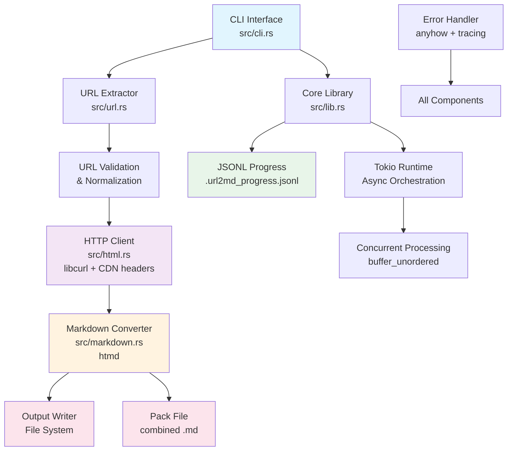

# Architecture

Deep dive into the technical architecture, design decisions, and implementation details of `twars-url2md`.

## System Overview

`twars-url2md` is a Rust application with a modular, async-first architecture. It uses **libcurl** for fetching and **htmd** for HTML-to-Markdown conversion, with no browser dependency.

<div class="arch-diagram">

</div>

## Core Components

### 1. CLI Interface (`src/cli.rs`)

Handles argument parsing and user interaction via `clap` derive macros.

**Key responsibilities:**

- Parse `--input`, `--output`, `--pack`, `--stdin`, `--verbose`, `--base-url`
- Validate mutual-exclusion rules (e.g. `--stdin` vs `--input`)
- Build the `Config` struct passed to `process_urls`

```rust
#[derive(Parser)]
#[command(name = "twars-url2md", version, about)]
pub struct Cli {
    #[arg(short, long)] input: Option<PathBuf>,
    #[arg(short, long)] output: Option<PathBuf>,
    #[arg(long)]        stdin: bool,
    #[arg(long)]        base_url: Option<String>,
    #[arg(short = 'p', long)] pack: Option<PathBuf>,
    #[arg(short, long)] verbose: bool,
}
```

### 2. URL Processing (`src/url.rs`)

Extracts, validates, and normalises URLs from arbitrary text input.

**Processing pipeline:**

1. Line-by-line scan — bare file paths (`/path/to/file.html`) converted to `file://` URLs
2. HTML-like lines parsed with `html5ever` to pull `href`/`src` attributes
3. Plain-text lines scanned with `linkify` for embedded URLs
4. Relative URLs resolved against `--base-url` if provided
5. Sort + `dedup` to produce a unique, deterministic list

```rust
pub fn extract_urls_from_text(text: &str, base_url: Option<&str>) -> Vec<String> {
    // … line scanning, HTML parsing, LinkFinder, resolution, dedup
}
```

### 3. HTTP Client (`src/html.rs`)

Fetches HTML via `libcurl` (the `curl` crate) running in a `spawn_blocking` thread to keep the Tokio event loop free.

**Why libcurl instead of `reqwest`?**  
libcurl ships as a system library on all major platforms and handles HTTP/2, TLS, proxy auth, and CDN quirks without an extra async runtime dependency.

### 4. Markdown Conversion (`src/markdown.rs`)

A thin wrapper around `htmd::convert`:

```rust
pub fn convert_html_to_markdown(html: &str) -> Result<String> {
    htmd::convert(html).context("Failed to convert HTML to Markdown")
}
```

`htmd` preserves headings, lists, tables, code blocks, links, and images while discarding script and style content.

### 5. Async Processing Engine (`src/lib.rs`)

`process_urls` orchestrates the batch using `futures::stream::buffer_unordered`:

```rust
pub async fn process_urls(urls: Vec<String>, config: Config)
    -> Result<Vec<(String, anyhow::Error)>>
{
    let concurrency = thread::available_parallelism()
        .map(|n| n.get() * 2)
        .unwrap_or(10);

    stream::iter(urls)
        .map(|url| process_one(url, &config))
        .buffer_unordered(concurrency)
        .collect::<Vec<_>>()
        .await
}
```

**Crash-safe progress tracking** — each successfully converted URL is appended to `.url2md_progress.jsonl` in the output directory.  On the next run, the file is read and those URLs are skipped.  Changing `--output` automatically starts a fresh run because the progress file lives inside the output directory.

---

## CDN Compatibility

Many CDNs and anti-bot systems inspect HTTP headers to distinguish real browsers from scrapers.  `fetch_html_with_curl` sends a complete set of Chromium-style headers:

| Header | Value / purpose |
|--------|----------------|
| `User-Agent` | Chromium 120 / macOS string |
| `Accept` | Full browser MIME list (HTML → image/avif → `*/*`) |
| `Accept-Language` | `en-US,en;q=0.9` |
| `Cache-Control` | `no-cache` (first-visit behaviour) |
| `Sec-Ch-Ua` | Chrome brand list — distinguishes from headless Chrome |
| `Sec-Ch-Ua-Mobile` | `?0` — desktop |
| `Sec-Ch-Ua-Platform` | `"macOS"` |
| `Sec-Fetch-Dest` | `document` — top-level navigation |
| `Sec-Fetch-Mode` | `navigate` |
| `Sec-Fetch-Site` | `none` — direct URL entry |
| `Sec-Fetch-User` | `?1` — user-gesture navigation |
| `Upgrade-Insecure-Requests` | `1` |

**HTTP version** — libcurl negotiates HTTP/2 where available.  Forcing HTTP/1.1 is a detectable fingerprint rejected by CDNs such as Adobe Experience Manager.

**Retry on transient failures** — exponential backoff (1 s, 2 s, 4 s …) handles rate-limit (`429`) and temporary server errors (`503`).

---

## Performance

### Adaptive concurrency

Concurrency is set to `available_parallelism × 2` at startup — I/O-bound work benefits from more in-flight requests than CPU cores.

### Benchmark reference (local machine, 2024 M2 MacBook Pro)

These figures come from the `tests/benchmarks.rs` suite and are provided as a rough baseline; actual throughput depends on network latency and page size.

| Workload | Typical throughput |
|----------|--------------------|
| URL extraction (10 000 URLs from text) | < 5 ms |
| Output path creation (1 000 paths) | < 1 ms |
| HTML → Markdown (typical article, ~50 KB) | < 50 ms |
| End-to-end (localhost mock server, 100 pages) | ~2–4 s |

### Release-build optimisations

```toml
[profile.release]
lto = true          # Link-time optimisation — smaller, faster binary
codegen-units = 1   # Single codegen unit for cross-crate inlining
opt-level = 3       # Maximum LLVM optimisation
strip = true        # Drop debug symbols to shrink binary
panic = "unwind"    # Keep unwinding so panic recovery works
```

---

## Error Handling

Errors flow through `anyhow::Error` and are never silently swallowed:

| Layer | Error type | Action |
|-------|-----------|--------|
| URL parsing | `url::ParseError` | Log + collect; skip URL |
| Network | `curl::Error` | Retry up to `max_retries` with backoff |
| HTTP status ≥ 400 | Status code | Retry or collect as failure |
| Content-type ≠ HTML | Non-HTML MIME | Skip (not an error) |
| File write | `std::io::Error` | Log + collect as failure |

After the batch completes, all failures are returned to the caller as `Vec<(String, anyhow::Error)>` — individual failures never abort processing of remaining URLs.

---

## Build Metadata

`build.rs` captures build-time information via the `built` crate:

```rust
pub fn version() -> String {
    format!(
        "{}\nBuild Time: {}\nTarget: {}\nProfile: {}",
        env!("CARGO_PKG_VERSION"),
        BUILT_TIME_UTC,
        TARGET,
        PROFILE
    )
}
```

It also extracts the version from `git describe` so pre-release binaries carry a `1.4.7-dev.3.gabc1234` version string rather than the stale Cargo.toml value.

---

## Testing Architecture

```
tests/
├── unit/url_tests.rs       # URL extraction, output path generation
├── integration/e2e_tests.rs # Full pipeline via mockito HTTP mock server
├── common/mod.rs            # Shared helpers (temp dirs, fixture loading)
├── fixtures/                # Static HTML inputs and expected Markdown
└── benchmarks.rs            # Criterion-style timing assertions
```

The `src/` modules also carry inline `#[cfg(test)]` suites covering:

- `src/lib.rs` — JSONL progress round-trips and crash-restart behaviour
- `src/html.rs` — Local `file://` fetch, retry logic, non-HTML skipping
- `src/markdown.rs` — Full HTML element coverage, Unicode, malformed input
- `src/url.rs` — URL extraction edge cases, deduplication, base-URL resolution
- `src/cli.rs` — Config creation, filename sanitisation, mixed-content input

---

**Design philosophy:** reliability first, then performance, then convenience.  The happy path is what remains after designing every failure mode.
